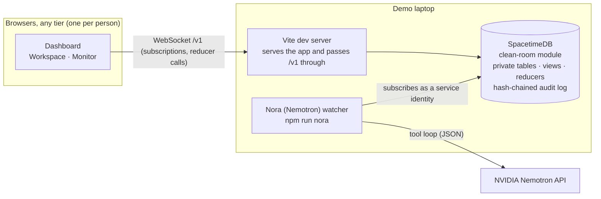

# Clean Room

**A live incident response room where every tier of the team works from one shared record, and Nora (Nemotron), an NVIDIA Nemotron analyst, investigates new evidence in the background and tells the right people what to check next.**

Built at HackUTD 2026 for the SpacetimeDB, Winstead (incident response), NVIDIA and CTF tracks.

In the first minutes of a breach people panic: plans get made on assumptions nobody wrote down, a new report contradicts them, and no one notices until it is too late. Clean Room keeps the plan, the evidence and the conversation in one live place, and has Nora (Nemotron) read every new piece of evidence against every open decision, so a contradiction surfaces in seconds with a calm, concrete next step. People decide; Nora only advises; everything is recorded in a tamper-evident log.

---

## How a problem flows

A human report → Nora (Nemotron) investigates → the team discusses → a human decides → someone verifies.

| # | What happens | Who |
|---|---|---|
| 1 | Open the incident and record what is affected | Incident lead (Tier 2+) |
| 2 | Record the plan as a decision, with the assumption it rests on ("Monday's backup predates the intrusion") | Tier 1+ records, Tier 2 approves |
| 3 | Add new evidence in the Workspace | Tier 1+ |
| 4 | Nora (Nemotron) investigates **immediately**, using tools to read the evidence, the decisions and their assumptions, earlier evidence and the discussion | Nora, in the background |
| 5 | She posts a suggested review on the decision, quoting the exact sentence from the evidence, and a note in the team discussion | Nora |
| 6 | Confirm the suggestion (the decision is flagged for review, team updates go out of date, verification is assigned), or dismiss it with feedback so Nora reassesses | Tier 1+ |
| 7 | The team coordinates live in that issue's own discussion ("Has restoration started?" "Not yet.") | Everyone |
| 8 | Hold or change the plan, and assign verification to a teammate | Tier 2+ |
| 9 | The assignee submits findings | Assignee |
| 10 | Nora checks the findings against the decision: they **support** it (Tier 2 can re-approve) or they **conflict** (back to step 5) | Nora advises, people approve |

**Branches:** evidence that affects no decision is saved quietly. Evidence that suggests urgent danger makes Nora recommend escalation and message the incident lead directly; a person confirms, and Nora never changes the plan herself. Closing a decision does not close the incident; the lead decides that separately.

## Tiers

Three tiers that **stack**: a higher tier can do everything a lower one can. The SpacetimeDB module enforces every rule on every call.

| Tier | Job | Adds |
|---|---|---|
| **Tier 1 · Triage** | Gather data, define problems and breaches | Add evidence, sources and scope; draft decisions; review suggestions; dismiss Nora's false alarms; discuss; submit findings |
| **Tier 2 · Containment** | Contain and mitigate | Approve and resolve decisions; approve Nora's fixes and undo her automatic ones; assign verification; team updates; incident status |
| **Tier 3 · Forensics** | Hunt hidden attackers, reverse engineer, establish what happened | Confirm or dispute evidence; manage Nora's memory; admit, re-tier and remove people; choose the incident lead |

## Nora (Nemotron): an agent, not a chatbot

Nora runs as her own service (`npm run nora`) with her own SpacetimeDB identity. Nobody chats with her; she watches the incident and acts on what changes.

- **New evidence** → an investigation loop of up to four Nemotron rounds with read-only tools: `list_decisions`, `get_decision`, `search_evidence`, `get_evidence`, `recent_discussion`, `open_tasks`. Verdicts: *no impact*, *conflict*, *urgent*, or *supports* (for verification findings).
- **Sign-ins** → flags unusual ones (leaked password, new device or network, abusive IP) and proposes one fix.
- **Dismissals with feedback** → reassesses the suggestion, and the feedback is kept in her memory for later findings. Learning means saved human decisions, not retraining.

**Hard rules sit above the model.** The module and the watcher reject a decision that does not exist or is closed, a quote that is not word for word in the evidence, an unknown action, or an ATT&CK id that is not in the local MITRE list. Sign-in severity has a floor and a ceiling computed from the facts. She can fix something on her own only when an admin rule allows exactly that action for that situation, and a Tier 2 can undo it. If Nemotron is unavailable she says so plainly instead of guessing.

## How each track is met

| Track | What we built |
|---|---|
| **SpacetimeDB** | All data lives in one SpacetimeDB module (26 tables). Every table is private; clients read only through per-person views filtered to incidents they are an active member of; every change goes through a reducer that checks identity and tier; every screen updates live through subscriptions. Two browsers, two laptops or a phone share the same incident with no refresh. |
| **Winstead: incident response** | The Workspace: every issue (decision) with its evidence, Nora (Nemotron)'s verdict inside "Review the decision", approval and assignment, verification findings, and its own live discussion for every tier; the Monitor for Nora's findings and the audit log, tiered access, and calm, ordered next steps from Nora to cut through the panic. |
| **NVIDIA: Nemotron beyond a chatbot** | Nora is a background agent on `nvidia/nemotron-3-ultra-550b-a55b` that investigates with tools, quotes her evidence, advises the tier that must act, escalates urgent danger, learns from feedback, and is boxed in by hard rules. |
| **CTF: forensics** | Every change, Nora's included, is written in the same transaction to a SHA-256 hash chain. The browser re-verifies the chain on every update ("Chain intact" / "broken at entry #N"); `tools/verify_audit.py` verifies an export independently; `tools/tamper_audit.py` demonstrates an attack and its detection. |

## Architecture



- `spacetimedb/`: the module. `src/index.ts` (tables, reducers, views), `src/rules.ts` (pure rules), `src/audit/` (hash chain). Tests in `spacetimedb/test/`.
- `server/nora/`: Nora (Nemotron): `investigate.ts` (evidence tool loop), `triage.ts` (sign-ins), `watcher.ts` (reacts to new rows), `spacetime.ts` (connection).
- `server/demo/`: `setup.ts` and `admit.ts`, run as the platform admin.
- `src/`: the dashboard. `live/live-adapter.ts` maps the module's views to the screens; `data/fixture-adapter.ts` is sample data for working without a backend.
- `shared/`: types and rules shared by the browser and the server; `module-rows.ts` holds the client row types, checked against the module by a test.

## Run it

You need Node 22+, the [SpacetimeDB CLI](https://spacetimedb.com/install) 2.14.1 and an NVIDIA API key from build.nvidia.com.

```bash
npm install
cd spacetimedb && npm install && cd ..
cp .env.example .env            # then put your key on the NVIDIA_API_KEY= line
npm run intel:fetch             # downloads the MITRE ATT&CK list Nora may cite
```

Start these in separate terminal tabs and leave them running:

```bash
spacetime start                             # tab 1: the database
npm run module:publish -- clean-room        # once, and after any module change
npm run nora                                # tab 2: Nora (Nemotron); prints her identity
npm run demo:setup -- --nora <her identity> # once: registers Nora, creates an incident
npm run dev                                 # tab 3: the dashboard (this laptop only)
npm run dev:lan                             #   or: reachable from phones/laptops on the same Wi-Fi
```

Open `http://127.0.0.1:5173/?data=live&as=lead&name=Alex`. The page shows this browser's ID; let it in once from a terminal:

```bash
npm run demo:admit -- --user <the 64-character ID> --tier tier3
```

After that, open **Administration → Create invite link** and send teammates the link: they type their name and they are in. Teammates on another network: run `npm run share` and replace the start of the link with the `https://….trycloudflare.com` address it prints. Each `?as=` name in the same browser is a separate person (for example `?as=analyst&name=Sam`), with its own saved login.

Without a backend, `npm run dev` and `http://127.0.0.1:5173/` show the same screens with sample data.

### Try Nora (Nemotron) without a database

```bash
npm run nora:try-evidence               # new evidence that conflicts with the plan
npm run nora:try-evidence -- urgent     # evidence that should be escalated
npm run nora:try-evidence -- unrelated  # evidence that affects no decision
npm run nora:try-evidence -- findings   # verification findings that support the plan
npm run nora:try                        # one suspicious sign-in
```

## Demo walkthrough (two windows, one laptop, about two minutes)

Setup, once: open two windows, `?data=live&as=commander&name=Morgan` and `?data=live&as=analyst&name=Sam`, copy the ID each shows, then
`npm run demo:setup -- --nora <Nora's ID> --commander <Morgan's ID> --analyst <Sam's ID>` and reload both. The new incident starts as **Awaiting information**, severity **Unknown**, with two confirmed decisions.

| # | Live action | What judges see |
|---|---|---|
| 1 | **Analyst**: Add finding → Prepared report "Sunday admin access" → Submit & analyze | The human report appears in both windows |
| 2 | Nora (Nemotron) investigates in the background (a few seconds) | An AI suggestion on "Restore the customer portal from Monday's backup", quoting the report, and her note in that issue's discussion |
| 3 | **Commander**: Review the decision → Flag & assign → Sam | The decision becomes Needs review; Next action: Sam, not acknowledged yet |
| 4 | **Analyst**: Acknowledge, replying "Checking the backup against the revised timeline." | The commander sees "Acknowledged" and the reply live |

Optional: "Save as finding" on any message turns it into a documented finding Nora analyzes; the analyst's Submit findings closes the loop and Nora reports whether they support the decision; Monitor shows every step in the audit chain ("Chain intact").

## Tests

```bash
npm test             # all suites
npm run typecheck    # dashboard, audit and server code
npm run check:server # the module and its tests
```

The suites cover the module's permissions and every reducer (run in-process with SpacetimeDB's test harness), the hash chain (attacks, TypeScript/Python agreement), the review rules, and Nora's triage, investigation loop and watcher (with a scripted stand-in for Nemotron). A schema test checks every hand-written client row and reducer argument against the module, so a mismatch fails in CI rather than at the demo.

## Security notes

- Keys live only in `.env` on the machine running Nora and are never sent to the browser or committed (`.gitignore`).
- The browser is never trusted: identity comes from the SpacetimeDB connection, and every reducer re-checks membership and tier. Rows the caller may not see are never sent to them.
- Evidence, discussion and sign-in fields are treated as untrusted data in every Nemotron prompt; whatever comes back is validated before anything is written.
- No passwords, hashes, 2FA secrets, phone numbers or precise locations are stored. All demo people and companies are invented.
- The audit chain is tamper-evident, not tamper-proof: someone with database access can still change rows, but not without the chain showing where.

## Troubleshooting

| Symptom | Fix |
|---|---|
| "Could not reach SpacetimeDB" / connection refused | `spacetime start` is not running. Start it in its own tab. |
| `spacetime.pid already exists` | A server is already running: check with `lsof -nP -iTCP:3000 -sTCP:LISTEN`. |
| "This browser is not a member of any incident yet" | Run the `demo:admit` command the page shows, or have a Tier 3 admit the ID from Administration, then press Try again. |
| Two tabs are the same person | Give each tab its own `?as=` name. |
| Nora sees nothing | Register her identity with `npm run demo:setup -- --nora <identity>`. |
| Duplicate findings | Only one `npm run nora` should run at a time (the module refuses duplicates either way). |
| `zsh: parse error` on a command | Do not type the `<` `>` placeholders; paste the real value. |
